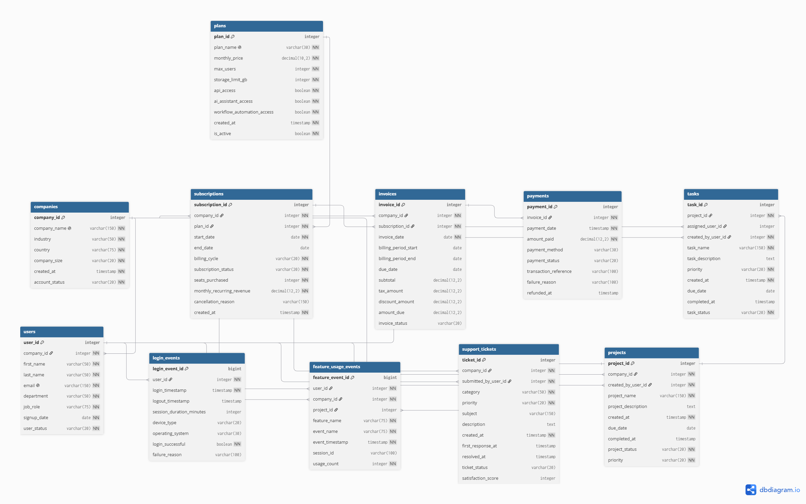

# Enterprise SaaS Analytics Platform

An end-to-end data analytics project that simulates the work of a Data Analyst at a B2B SaaS company.

**Status:** In Progress - database design, synthetic data generation, ETL, and SQL analysis are implemented; Power BI dashboards and final reporting are still in development.

## Project Goals

- Design a realistic relational database
- Generate synthetic SaaS business data
- Analyze product usage, customers, subscriptions, and revenue
- Write advanced SQL queries
- Build dashboards in Power BI
- Present actionable business insights

## Technologies

- Python
- PostgreSQL
- SQL
- Pandas
- Faker
- Power BI
- Git and GitHub

## Database Design

The Kraly analytics platform uses a relational PostgreSQL database designed to capture customer subscriptions, product usage, project activity, support interactions, and billing data.

